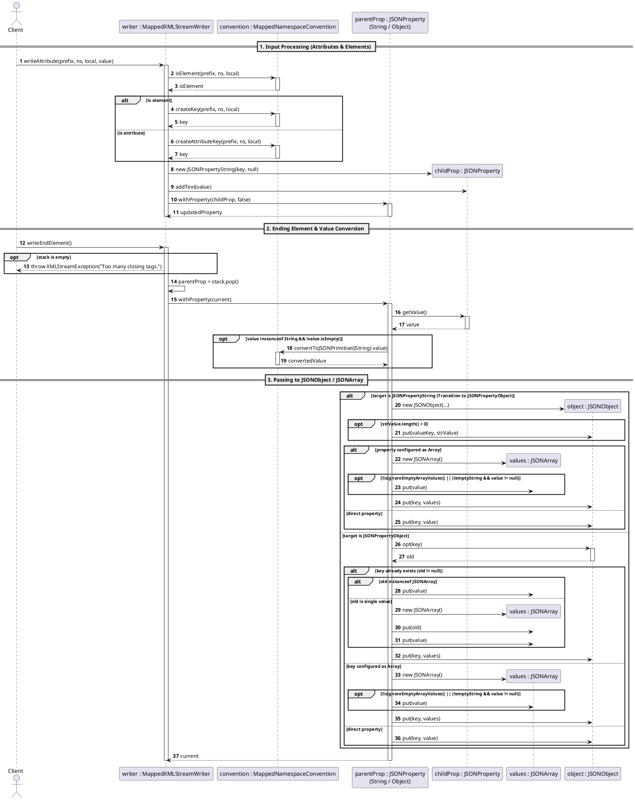

# aider chat started at 2026-10-11 16:00:56

> Aider respects your privacy and never collects your code, chat messages, keys or personal info.  
> For more info: https://aider.chat/docs/more/analytics.html  
> Allow collection of anonymous analytics to help improve aider? (Y)es/(N)o [Yes]: y  
> You can skip this check with --no-gitignore  
> Add .aider* to .gitignore (recommended)? (Y)es/(N)o [Yes]: y  
> Added .aider* to .gitignore  
> /home/codespace/.local/bin/aider --list-models gemini/  
> Models which match "gemini/":  
> - gemini/deep-research-max-preview-04-2026  
> - gemini/deep-research-preview-04-2026  
> - gemini/deep-research-pro-preview-12-2025  
> - gemini/gemini-2.5-computer-use-preview-10-2025  
> - gemini/gemini-2.5-flash  
> - gemini/gemini-2.5-flash-lite  
> - gemini/gemini-2.5-flash-lite-preview-06-17  
> - gemini/gemini-2.5-pro  
> - gemini/gemini-2.5-pro-exp-03-25  
> - gemini/gemini-2.5-pro-preview-05-06  
> - gemini/gemini-2.5-pro-preview-06-05  
> - gemini/gemini-2.5-pro-preview-tts  
> - gemini/gemini-3-flash-preview  
> - gemini/gemini-3.1-flash-lite  
> - gemini/gemini-3.1-flash-lite-preview  
> - gemini/gemini-3.1-pro-preview  
> - gemini/gemini-3.1-pro-preview-customtools  
> - gemini/gemini-3.5-flash  
> - gemini/gemini-3.5-flash-lite  
> - gemini/gemini-3.6-flash  
> - gemini/gemini-3.7-flash  
> - gemini/gemini-3.8-flash  
> - gemini/gemini-exp-1114  
> - gemini/gemini-exp-1206  
> - gemini/gemini-flash-latest  
> - gemini/gemini-flash-lite-latest  
> - gemini/gemini-gemma-2-27b-it  
> - gemini/gemini-gemma-2-9b-it  
> - gemini/gemini-omni-1.1-flash  
> - gemini/gemini-omni-flash-preview  
> - gemini/gemini-pro-latest  
> - gemini/gemini-robotics-er-2-preview  
> - gemini/gemini-robotics-er-2-streaming-preview  
> - gemini/gemma-3-27b-it  
> - gemini/gemma-4-26b-a4b-it  
> - gemini/gemma-4-31b-it  
> - gemini/learnlm-1.5-pro-experimental  
> - gemini/lyria-3-clip-preview  
> - gemini/lyria-3-pro-preview  
> - gemini/lyria-3.5  
> - gemini/lyria-3.5-clip-preview  
> - gemini/lyria-3.5-pro-preview  
> - gemini/lyria-realtime-exp  

# aider chat started at 2026-10-11 16:09:13

> /home/codespace/.local/bin/aider --list-models gemini/gemini  
> Models which match "gemini/gemini":  
> - gemini/gemini-2.5-computer-use-preview-10-2025  
> - gemini/gemini-2.5-flash  
> - gemini/gemini-2.5-flash-lite  
> - gemini/gemini-2.5-flash-lite-preview-06-17  
> - gemini/gemini-2.5-pro  
> - gemini/gemini-2.5-pro-exp-03-25  
> - gemini/gemini-2.5-pro-preview-05-06  
> - gemini/gemini-2.5-pro-preview-06-05  
> - gemini/gemini-2.5-pro-preview-tts  
> - gemini/gemini-3-flash-preview  
> - gemini/gemini-3.1-flash-lite  
> - gemini/gemini-3.1-flash-lite-preview  
> - gemini/gemini-3.1-pro-preview  
> - gemini/gemini-3.1-pro-preview-customtools  
> - gemini/gemini-3.5-flash  
> - gemini/gemini-3.5-flash-lite  
> - gemini/gemini-3.6-flash  
> - gemini/gemini-3.7-flash  
> - gemini/gemini-3.8-flash  
> - gemini/gemini-exp-1114  
> - gemini/gemini-exp-1206  
> - gemini/gemini-flash-latest  
> - gemini/gemini-flash-lite-latest  
> - gemini/gemini-gemma-2-27b-it  
> - gemini/gemini-gemma-2-9b-it  
> - gemini/gemini-omni-1.1-flash  
> - gemini/gemini-omni-flash-preview  
> - gemini/gemini-pro-latest  
> - gemini/gemini-robotics-er-2-preview  
> - gemini/gemini-robotics-er-2-streaming-preview  

# aider chat started at 2026-10-11 16:28:24

> /home/codespace/.local/bin/aider --chat-mode ask --no-auto-commits --model gemini/gemini-pro-latest  
> Aider v0.86.2  
> Model: gemini/gemini-pro-latest with ask edit format  
> Git repo: .git with 61 files  
> Repo-map: using 4096 tokens, auto refresh  

#### List the main packages in src/main/java and describe in one line what each does. Cite file paths.  
> litellm.RateLimitError: litellm.RateLimitError: vertex_ai_betaException - b'{\n  "error": {\n    "code": 429,\n    "message": "You exceeded your current quota, please check your plan and billing details. For more information on this error, head to: https://ai.google.dev/gemini-api/docs/rate-limits. To monitor your current usage, head to: https://ai.dev/rate-limit. \\n* Quota exceeded for metric: generativelanguage.googleapis.com/generate_content_free_tier_requests, limit: 0, model: gemini-3.1-pro\\n* Quota exceeded for metric: generativelanguage.googleapis.com/generate_content_free_tier_requests, limit: 0, model: gemini-3.1-pro\\n* Quota exceeded for metric: generativelanguage.googleapis.com/generate_content_free_tier_input_token_count, limit: 0, model: gemini-3.1-pro\\n* Quota exceeded for metric: generativelanguage.googleapis.com/generate_content_free_tier_input_token_count, limit: 0, model: gemini-3.1-pro\\nPlease retry in 7h30m5.127263164s.",\n    "status": "RESOURCE_EXHAUSTED",\n    "details": [\n      {\n        "@type": "type.googleapis.com/google.rpc.Help",\n        "links": [\n          {\n            "description": "Learn more about Gemini API quotas",\n            "url": "https://ai.google.dev/gemini-api/docs/rate-limits"\n          }\n        ]\n      },\n      {\n        "@type": "type.googleapis.com/google.rpc.QuotaFailure",\n        "violations": [\n          {\n            "quotaMetric": "generativelanguage.googleapis.com/generate_content_free_tier_requests",\n            "quotaId": "GenerateRequestsPerDayPerProjectPerModel-FreeTier",\n            "quotaDimensions": {\n              "location": "global",\n              "model": "gemini-3.1-pro"\n            }\n          },\n          {\n            "quotaMetric": "generativelanguage.googleapis.com/generate_content_free_tier_requests",\n            "quotaId": "GenerateRequestsPerMinutePerProjectPerModel-FreeTier",\n            "quotaDimensions": {\n              "location": "global",\n              "model": "gemini-3.1-pro"\n            }\n          },\n          {\n            "quotaMetric": "generativelanguage.googleapis.com/generate_content_free_tier_input_token_count",\n            "quotaId": "GenerateContentInputTokensPerModelPerMinute-FreeTier",\n            "quotaDimensions": {\n              "model": "gemini-3.1-pro",\n              "location": "global"\n            }\n          },\n          {\n            "quotaMetric": "generativelanguage.googleapis.com/generate_content_free_tier_input_token_count",\n            "quotaId": "GenerateContentInputTokensPerModelPerDay-FreeTier",\n            "quotaDimensions": {\n              "location": "global",\n              "model": "gemini-3.1-pro"\n            }\n          }\n        ]\n      },\n      {\n        "@type": "type.googleapis.com/google.rpc.RetryInfo",\n        "retryDelay": "27005s"\n      }\n    ]\n  }\n}\n'  
> The API provider has rate limited you. Try again later or check your quotas.  
> Retrying in 0.2 seconds...  
> litellm.RateLimitError: litellm.RateLimitError: vertex_ai_betaException - b'{\n  "error": {\n    "code": 429,\n    "message": "You exceeded your current quota, please check your plan and billing details. For more information on this error, head to: https://ai.google.dev/gemini-api/docs/rate-limits. To monitor your current usage, head to: https://ai.dev/rate-limit. \\n* Quota exceeded for metric: generativelanguage.googleapis.com/generate_content_free_tier_input_token_count, limit: 0, model: gemini-3.1-pro\\n* Quota exceeded for metric: generativelanguage.googleapis.com/generate_content_free_tier_requests, limit: 0, model: gemini-3.1-pro\\n* Quota exceeded for metric: generativelanguage.googleapis.com/generate_content_free_tier_requests, limit: 0, model: gemini-3.1-pro\\n* Quota exceeded for metric: generativelanguage.googleapis.com/generate_content_free_tier_input_token_count, limit: 0, model: gemini-3.1-pro\\nPlease retry in 7h30m4.755530542s.",\n    "status": "RESOURCE_EXHAUSTED",\n    "details": [\n      {\n        "@type": "type.googleapis.com/google.rpc.Help",\n        "links": [\n          {\n            "description": "Learn more about Gemini API quotas",\n            "url": "https://ai.google.dev/gemini-api/docs/rate-limits"\n          }\n        ]\n      },\n      {\n        "@type": "type.googleapis.com/google.rpc.QuotaFailure",\n        "violations": [\n          {\n            "quotaMetric": "generativelanguage.googleapis.com/generate_content_free_tier_input_token_count",\n            "quotaId": "GenerateContentInputTokensPerModelPerMinute-FreeTier",\n            "quotaDimensions": {\n              "location": "global",\n              "model": "gemini-3.1-pro"\n            }\n          },\n          {\n            "quotaMetric": "generativelanguage.googleapis.com/generate_content_free_tier_requests",\n            "quotaId": "GenerateRequestsPerMinutePerProjectPerModel-FreeTier",\n            "quotaDimensions": {\n              "model": "gemini-3.1-pro",\n              "location": "global"\n            }\n          },\n          {\n            "quotaMetric": "generativelanguage.googleapis.com/generate_content_free_tier_requests",\n            "quotaId": "GenerateRequestsPerDayPerProjectPerModel-FreeTier",\n            "quotaDimensions": {\n              "model": "gemini-3.1-pro",\n              "location": "global"\n            }\n          },\n          {\n            "quotaMetric": "generativelanguage.googleapis.com/generate_content_free_tier_input_token_count",\n            "quotaId": "GenerateContentInputTokensPerModelPerDay-FreeTier",\n            "quotaDimensions": {\n              "location": "global",\n              "model": "gemini-3.1-pro"\n            }\n          }\n        ]\n      },\n      {\n        "@type": "type.googleapis.com/google.rpc.RetryInfo",\n        "retryDelay": "27004s"\n      }\n    ]\n  }\n}\n'  
> The API provider has rate limited you. Try again later or check your quotas.  
> Retrying in 0.5 seconds...  
> litellm.RateLimitError: litellm.RateLimitError: vertex_ai_betaException - b'{\n  "error": {\n    "code": 429,\n    "message": "You exceeded your current quota, please check your plan and billing details. For more information on this error, head to: https://ai.google.dev/gemini-api/docs/rate-limits. To monitor your current usage, head to: https://ai.dev/rate-limit. \\n* Quota exceeded for metric: generativelanguage.googleapis.com/generate_content_free_tier_requests, limit: 0, model: gemini-3.1-pro\\n* Quota exceeded for metric: generativelanguage.googleapis.com/generate_content_free_tier_requests, limit: 0, model: gemini-3.1-pro\\n* Quota exceeded for metric: generativelanguage.googleapis.com/generate_content_free_tier_input_token_count, limit: 0, model: gemini-3.1-pro\\n* Quota exceeded for metric: generativelanguage.googleapis.com/generate_content_free_tier_input_token_count, limit: 0, model: gemini-3.1-pro\\nPlease retry in 7h30m4.137621759s.",\n    "status": "RESOURCE_EXHAUSTED",\n    "details": [\n      {\n        "@type": "type.googleapis.com/google.rpc.Help",\n        "links": [\n          {\n            "description": "Learn more about Gemini API quotas",\n            "url": "https://ai.google.dev/gemini-api/docs/rate-limits"\n          }\n        ]\n      },\n      {\n        "@type": "type.googleapis.com/google.rpc.QuotaFailure",\n        "violations": [\n          {\n            "quotaMetric": "generativelanguage.googleapis.com/generate_content_free_tier_requests",\n            "quotaId": "GenerateRequestsPerDayPerProjectPerModel-FreeTier",\n            "quotaDimensions": {\n              "location": "global",\n              "model": "gemini-3.1-pro"\n            }\n          },\n          {\n            "quotaMetric": "generativelanguage.googleapis.com/generate_content_free_tier_requests",\n            "quotaId": "GenerateRequestsPerMinutePerProjectPerModel-FreeTier",\n            "quotaDimensions": {\n              "location": "global",\n              "model": "gemini-3.1-pro"\n            }\n          },\n          {\n            "quotaMetric": "generativelanguage.googleapis.com/generate_content_free_tier_input_token_count",\n            "quotaId": "GenerateContentInputTokensPerModelPerMinute-FreeTier",\n            "quotaDimensions": {\n              "model": "gemini-3.1-pro",\n              "location": "global"\n            }\n          },\n          {\n            "quotaMetric": "generativelanguage.googleapis.com/generate_content_free_tier_input_token_count",\n            "quotaId": "GenerateContentInputTokensPerModelPerDay-FreeTier",\n            "quotaDimensions": {\n              "model": "gemini-3.1-pro",\n              "location": "global"\n            }\n          }\n        ]\n      },\n      {\n        "@type": "type.googleapis.com/google.rpc.RetryInfo",\n        "retryDelay": "27004s"\n      }\n    ]\n  }\n}\n'  
> The API provider has rate limited you. Try again later or check your quotas.  
> Retrying in 1.0 seconds...  
> litellm.RateLimitError: litellm.RateLimitError: vertex_ai_betaException - b'{\n  "error": {\n    "code": 429,\n    "message": "You exceeded your current quota, please check your plan and billing details. For more information on this error, head to: https://ai.google.dev/gemini-api/docs/rate-limits. To monitor your current usage, head to: https://ai.dev/rate-limit. \\n* Quota exceeded for metric: generativelanguage.googleapis.com/generate_content_free_tier_input_token_count, limit: 0, model: gemini-3.1-pro\\n* Quota exceeded for metric: generativelanguage.googleapis.com/generate_content_free_tier_input_token_count, limit: 0, model: gemini-3.1-pro\\n* Quota exceeded for metric: generativelanguage.googleapis.com/generate_content_free_tier_requests, limit: 0, model: gemini-3.1-pro\\n* Quota exceeded for metric: generativelanguage.googleapis.com/generate_content_free_tier_requests, limit: 0, model: gemini-3.1-pro\\nPlease retry in 7h30m3.017845656s.",\n    "status": "RESOURCE_EXHAUSTED",\n    "details": [\n      {\n        "@type": "type.googleapis.com/google.rpc.Help",\n        "links": [\n          {\n            "description": "Learn more about Gemini API quotas",\n            "url": "https://ai.google.dev/gemini-api/docs/rate-limits"\n          }\n        ]\n      },\n      {\n        "@type": "type.googleapis.com/google.rpc.QuotaFailure",\n        "violations": [\n          {\n            "quotaMetric": "generativelanguage.googleapis.com/generate_content_free_tier_input_token_count",\n            "quotaId": "GenerateContentInputTokensPerModelPerDay-FreeTier",\n            "quotaDimensions": {\n              "location": "global",\n              "model": "gemini-3.1-pro"\n            }\n          },\n          {\n            "quotaMetric": "generativelanguage.googleapis.com/generate_content_free_tier_input_token_count",\n            "quotaId": "GenerateContentInputTokensPerModelPerMinute-FreeTier",\n            "quotaDimensions": {\n              "model": "gemini-3.1-pro",\n              "location": "global"\n            }\n          },\n          {\n            "quotaMetric": "generativelanguage.googleapis.com/generate_content_free_tier_requests",\n            "quotaId": "GenerateRequestsPerMinutePerProjectPerModel-FreeTier",\n            "quotaDimensions": {\n              "location": "global",\n              "model": "gemini-3.1-pro"\n            }\n          },\n          {\n            "quotaMetric": "generativelanguage.googleapis.com/generate_content_free_tier_requests",\n            "quotaId": "GenerateRequestsPerDayPerProjectPerModel-FreeTier",\n            "quotaDimensions": {\n              "location": "global",\n              "model": "gemini-3.1-pro"\n            }\n          }\n        ]\n      },\n      {\n        "@type": "type.googleapis.com/google.rpc.RetryInfo",\n        "retryDelay": "27003s"\n      }\n    ]\n  }\n}\n'  
> The API provider has rate limited you. Try again later or check your quotas.  
> Retrying in 2.0 seconds...  
> litellm.RateLimitError: litellm.RateLimitError: vertex_ai_betaException - b'{\n  "error": {\n    "code": 429,\n    "message": "You exceeded your current quota, please check your plan and billing details. For more information on this error, head to: https://ai.google.dev/gemini-api/docs/rate-limits. To monitor your current usage, head to: https://ai.dev/rate-limit. \\n* Quota exceeded for metric: generativelanguage.googleapis.com/generate_content_free_tier_input_token_count, limit: 0, model: gemini-3.1-pro\\n* Quota exceeded for metric: generativelanguage.googleapis.com/generate_content_free_tier_requests, limit: 0, model: gemini-3.1-pro\\n* Quota exceeded for metric: generativelanguage.googleapis.com/generate_content_free_tier_requests, limit: 0, model: gemini-3.1-pro\\n* Quota exceeded for metric: generativelanguage.googleapis.com/generate_content_free_tier_input_token_count, limit: 0, model: gemini-3.1-pro\\nPlease retry in 7h30m0.90397991s.",\n    "status": "RESOURCE_EXHAUSTED",\n    "details": [\n      {\n        "@type": "type.googleapis.com/google.rpc.Help",\n        "links": [\n          {\n            "description": "Learn more about Gemini API quotas",\n            "url": "https://ai.google.dev/gemini-api/docs/rate-limits"\n          }\n        ]\n      },\n      {\n        "@type": "type.googleapis.com/google.rpc.QuotaFailure",\n        "violations": [\n          {\n            "quotaMetric": "generativelanguage.googleapis.com/generate_content_free_tier_input_token_count",\n            "quotaId": "GenerateContentInputTokensPerModelPerDay-FreeTier",\n            "quotaDimensions": {\n              "location": "global",\n              "model": "gemini-3.1-pro"\n            }\n          },\n          {\n            "quotaMetric": "generativelanguage.googleapis.com/generate_content_free_tier_requests",\n            "quotaId": "GenerateRequestsPerDayPerProjectPerModel-FreeTier",\n            "quotaDimensions": {\n              "location": "global",\n              "model": "gemini-3.1-pro"\n            }\n          },\n          {\n            "quotaMetric": "generativelanguage.googleapis.com/generate_content_free_tier_requests",\n            "quotaId": "GenerateRequestsPerMinutePerProjectPerModel-FreeTier",\n            "quotaDimensions": {\n              "location": "global",\n              "model": "gemini-3.1-pro"\n            }\n          },\n          {\n            "quotaMetric": "generativelanguage.googleapis.com/generate_content_free_tier_input_token_count",\n            "quotaId": "GenerateContentInputTokensPerModelPerMinute-FreeTier",\n            "quotaDimensions": {\n              "location": "global",\n              "model": "gemini-3.1-pro"\n            }\n          }\n        ]\n      },\n      {\n        "@type": "type.googleapis.com/google.rpc.RetryInfo",\n        "retryDelay": "27000s"\n      }\n    ]\n  }\n}\n'  
> The API provider has rate limited you. Try again later or check your quotas.  
> Retrying in 4.0 seconds...  
> litellm.RateLimitError: litellm.RateLimitError: vertex_ai_betaException - b'{\n  "error": {\n    "code": 429,\n    "message": "You exceeded your current quota, please check your plan and billing details. For more information on this error, head to: https://ai.google.dev/gemini-api/docs/rate-limits. To monitor your current usage, head to: https://ai.dev/rate-limit. \\n* Quota exceeded for metric: generativelanguage.googleapis.com/generate_content_free_tier_requests, limit: 0, model: gemini-3.1-pro\\n* Quota exceeded for metric: generativelanguage.googleapis.com/generate_content_free_tier_requests, limit: 0, model: gemini-3.1-pro\\n* Quota exceeded for metric: generativelanguage.googleapis.com/generate_content_free_tier_input_token_count, limit: 0, model: gemini-3.1-pro\\n* Quota exceeded for metric: generativelanguage.googleapis.com/generate_content_free_tier_input_token_count, limit: 0, model: gemini-3.1-pro\\nPlease retry in 7h29m56.783826548s.",\n    "status": "RESOURCE_EXHAUSTED",\n    "details": [\n      {\n        "@type": "type.googleapis.com/google.rpc.Help",\n        "links": [\n          {\n            "description": "Learn more about Gemini API quotas",\n            "url": "https://ai.google.dev/gemini-api/docs/rate-limits"\n          }\n        ]\n      },\n      {\n        "@type": "type.googleapis.com/google.rpc.QuotaFailure",\n        "violations": [\n          {\n            "quotaMetric": "generativelanguage.googleapis.com/generate_content_free_tier_requests",\n            "quotaId": "GenerateRequestsPerDayPerProjectPerModel-FreeTier",\n            "quotaDimensions": {\n              "location": "global",\n              "model": "gemini-3.1-pro"\n            }\n          },\n          {\n            "quotaMetric": "generativelanguage.googleapis.com/generate_content_free_tier_requests",\n            "quotaId": "GenerateRequestsPerMinutePerProjectPerModel-FreeTier",\n            "quotaDimensions": {\n              "location": "global",\n              "model": "gemini-3.1-pro"\n            }\n          },\n          {\n            "quotaMetric": "generativelanguage.googleapis.com/generate_content_free_tier_input_token_count",\n            "quotaId": "GenerateContentInputTokensPerModelPerMinute-FreeTier",\n            "quotaDimensions": {\n              "location": "global",\n              "model": "gemini-3.1-pro"\n            }\n          },\n          {\n            "quotaMetric": "generativelanguage.googleapis.com/generate_content_free_tier_input_token_count",\n            "quotaId": "GenerateContentInputTokensPerModelPerDay-FreeTier",\n            "quotaDimensions": {\n              "location": "global",\n              "model": "gemini-3.1-pro"\n            }\n          }\n        ]\n      },\n      {\n        "@type": "type.googleapis.com/google.rpc.RetryInfo",\n        "retryDelay": "26996s"\n      }\n    ]\n  }\n}\n'  
> The API provider has rate limited you. Try again later or check your quotas.  
> Retrying in 8.0 seconds...  
> litellm.RateLimitError: litellm.RateLimitError: vertex_ai_betaException - b'{\n  "error": {\n    "code": 429,\n    "message": "You exceeded your current quota, please check your plan and billing details. For more information on this error, head to: https://ai.google.dev/gemini-api/docs/rate-limits. To monitor your current usage, head to: https://ai.dev/rate-limit. \\n* Quota exceeded for metric: generativelanguage.googleapis.com/generate_content_free_tier_requests, limit: 0, model: gemini-3.1-pro\\n* Quota exceeded for metric: generativelanguage.googleapis.com/generate_content_free_tier_requests, limit: 0, model: gemini-3.1-pro\\n* Quota exceeded for metric: generativelanguage.googleapis.com/generate_content_free_tier_input_token_count, limit: 0, model: gemini-3.1-pro\\n* Quota exceeded for metric: generativelanguage.googleapis.com/generate_content_free_tier_input_token_count, limit: 0, model: gemini-3.1-pro\\nPlease retry in 7h29m48.655867897s.",\n    "status": "RESOURCE_EXHAUSTED",\n    "details": [\n      {\n        "@type": "type.googleapis.com/google.rpc.Help",\n        "links": [\n          {\n            "description": "Learn more about Gemini API quotas",\n            "url": "https://ai.google.dev/gemini-api/docs/rate-limits"\n          }\n        ]\n      },\n      {\n        "@type": "type.googleapis.com/google.rpc.QuotaFailure",\n        "violations": [\n          {\n            "quotaMetric": "generativelanguage.googleapis.com/generate_content_free_tier_requests",\n            "quotaId": "GenerateRequestsPerDayPerProjectPerModel-FreeTier",\n            "quotaDimensions": {\n              "model": "gemini-3.1-pro",\n              "location": "global"\n            }\n          },\n          {\n            "quotaMetric": "generativelanguage.googleapis.com/generate_content_free_tier_requests",\n            "quotaId": "GenerateRequestsPerMinutePerProjectPerModel-FreeTier",\n            "quotaDimensions": {\n              "location": "global",\n              "model": "gemini-3.1-pro"\n            }\n          },\n          {\n            "quotaMetric": "generativelanguage.googleapis.com/generate_content_free_tier_input_token_count",\n            "quotaId": "GenerateContentInputTokensPerModelPerMinute-FreeTier",\n            "quotaDimensions": {\n              "location": "global",\n              "model": "gemini-3.1-pro"\n            }\n          },\n          {\n            "quotaMetric": "generativelanguage.googleapis.com/generate_content_free_tier_input_token_count",\n            "quotaId": "GenerateContentInputTokensPerModelPerDay-FreeTier",\n            "quotaDimensions": {\n              "location": "global",\n              "model": "gemini-3.1-pro"\n            }\n          }\n        ]\n      },\n      {\n        "@type": "type.googleapis.com/google.rpc.RetryInfo",\n        "retryDelay": "26988s"\n      }\n    ]\n  }\n}\n'  
> The API provider has rate limited you. Try again later or check your quotas.  
> Retrying in 16.0 seconds...  
> litellm.RateLimitError: litellm.RateLimitError: vertex_ai_betaException - b'{\n  "error": {\n    "code": 429,\n    "message": "You exceeded your current quota, please check your plan and billing details. For more information on this error, head to: https://ai.google.dev/gemini-api/docs/rate-limits. To monitor your current usage, head to: https://ai.dev/rate-limit. \\n* Quota exceeded for metric: generativelanguage.googleapis.com/generate_content_free_tier_input_token_count, limit: 0, model: gemini-3.1-pro\\n* Quota exceeded for metric: generativelanguage.googleapis.com/generate_content_free_tier_requests, limit: 0, model: gemini-3.1-pro\\n* Quota exceeded for metric: generativelanguage.googleapis.com/generate_content_free_tier_requests, limit: 0, model: gemini-3.1-pro\\n* Quota exceeded for metric: generativelanguage.googleapis.com/generate_content_free_tier_input_token_count, limit: 0, model: gemini-3.1-pro\\nPlease retry in 7h29m32.529682991s.",\n    "status": "RESOURCE_EXHAUSTED",\n    "details": [\n      {\n        "@type": "type.googleapis.com/google.rpc.Help",\n        "links": [\n          {\n            "description": "Learn more about Gemini API quotas",\n            "url": "https://ai.google.dev/gemini-api/docs/rate-limits"\n          }\n        ]\n      },\n      {\n        "@type": "type.googleapis.com/google.rpc.QuotaFailure",\n        "violations": [\n          {\n            "quotaMetric": "generativelanguage.googleapis.com/generate_content_free_tier_input_token_count",\n            "quotaId": "GenerateContentInputTokensPerModelPerDay-FreeTier",\n            "quotaDimensions": {\n              "location": "global",\n              "model": "gemini-3.1-pro"\n            }\n          },\n          {\n            "quotaMetric": "generativelanguage.googleapis.com/generate_content_free_tier_requests",\n            "quotaId": "GenerateRequestsPerDayPerProjectPerModel-FreeTier",\n            "quotaDimensions": {\n              "model": "gemini-3.1-pro",\n              "location": "global"\n            }\n          },\n          {\n            "quotaMetric": "generativelanguage.googleapis.com/generate_content_free_tier_requests",\n            "quotaId": "GenerateRequestsPerMinutePerProjectPerModel-FreeTier",\n            "quotaDimensions": {\n              "location": "global",\n              "model": "gemini-3.1-pro"\n            }\n          },\n          {\n            "quotaMetric": "generativelanguage.googleapis.com/generate_content_free_tier_input_token_count",\n            "quotaId": "GenerateContentInputTokensPerModelPerMinute-FreeTier",\n            "quotaDimensions": {\n              "location": "global",\n              "model": "gemini-3.1-pro"\n            }\n          }\n        ]\n      },\n      {\n        "@type": "type.googleapis.com/google.rpc.RetryInfo",\n        "retryDelay": "26972s"\n      }\n    ]\n  }\n}\n'  
> The API provider has rate limited you. Try again later or check your quotas.  
> Retrying in 32.0 seconds...  

# aider chat started at 2026-10-11 16:33:46

> /home/codespace/.local/bin/aider --chat-mode ask --no-auto-commits --model gemini/gemini-flash-latest  
> Aider v0.86.2  
> Model: gemini/gemini-flash-latest with ask edit format  
> Git repo: .git with 61 files  
> Repo-map: using 4096 tokens, auto refresh  

#### List the main packages in src/main/java and describe in one line what each does. Cite file paths.  

Here are the main packages in `src/main/java`:

* **`org.codehaus.jettison`**
  Provides core interfaces, exceptions, node representations, and abstract base classes for bridging StAX XML stream processing and JSON.
  *File paths:* `src/main/java/org/codehaus/jettison/AbstractXMLInputFactory.java`, `src/main/java/org/codehaus/jettison/AbstractXMLOutputFactory.java`, `src/main/java/org/codehaus/jettison/AbstractXMLStreamReader.java`, `src/main/java/org/codehaus/jettison/Convention.java`, `src/main/java/org/codehaus/jettison/Node.java`

* **`org.codehaus.jettison.badgerfish`**
  Implements XML-to-JSON and JSON-to-XML stream reading and writing according to the BadgerFish convention.
  *File paths:* `src/main/java/org/codehaus/jettison/badgerfish/BadgerFishConvention.java`, `src/main/java/org/codehaus/jettison/badgerfish/BadgerFishXMLInputFactory.java`, `src/main/java/org/codehaus/jettison/badgerfish/BadgerFishXMLOutputFactory.java`, `src/main/java/org/codehaus/jettison/badgerfish/BadgerFishXMLStreamReader.java`, `src/main/java/org/codehaus/jettison/badgerfish/BadgerFishXMLStreamWriter.java`

* **`org.codehaus.jettison.json`**
  Provides fundamental JSON models and utilities for tokenizing, parsing, and formatting JSON structures.
  *File paths:* `src/main/java/org/codehaus/jettison/json/JSONObject.java`, `src/main/java/org/codehaus/jettison/json/JSONArray.java`, `src/main/java/org/codehaus/jettison/json/JSONTokener.java`, `src/main/java/org/codehaus/jettison/json/JSONException.java`, `src/main/java/org/codehaus/jettison/json/JSONStringer.java`

* **`org.codehaus.jettison.mapped`**
  Implements XML-to-JSON and JSON-to-XML stream processing using configurable mapped namespace conventions and data type conversion.
  *File paths:* `src/main/java/org/codehaus/jettison/mapped/Configuration.java`, `src/main/java/org/codehaus/jettison/mapped/MappedNamespaceConvention.java`, `src/main/java/org/codehaus/jettison/mapped/MappedXMLInputFactory.java`, `src/main/java/org/codehaus/jettison/mapped/MappedXMLOutputFactory.java`, `src/main/java/org/codehaus/jettison/mapped/MappedXMLStreamReader.java`, `src/main/java/org/codehaus/jettison/mapped/MappedXMLStreamWriter.java`, `src/main/java/org/codehaus/jettison/mapped/TypeConverter.java`

> Tokens: 8.2k sent, 566 received. Cost: $0.0083 message, $0.0083 session.  
> src/main/java/org/codehaus/jettison/AbstractXMLInputFactory.java  

# aider chat started at 2026-10-13 22:57:18

> /home/codespace/.local/bin/aider --chat-mode ask --no-auto-commits --map-tokens 2048 --model gemini/gemini-flash-latest  
> Aider v0.86.2  
> Model: gemini/gemini-flash-latest with ask edit format  
> Git repo: .git with 61 files  
> Repo-map: using 2048 tokens, auto refresh  

#### Analyze the workspace repository map. Trace the execution flow from main entry point down to core initialization. Output the result as a Markdown call flow tree. if unsure, say so  

I am unsure of a specific standalone application `main` entry point, as Jettison is a library without a `public static void main(String[] args)` entry point visible in the codebase.

However, tracing the primary library entry point for initializing and creating a stream reader from JSON (using `MappedXMLInputFactory`) down to its core components yields the following flow:

```markdown
MappedXMLInputFactory.createXMLStreamReader(JSONTokener tokener)
└── MappedXMLInputFactory.createJSONObject(JSONTokener tokener)
    └── JSONObject.<init>(JSONTokener x)
        └── JSONTokener.nextClean()
        └── JSONTokener.nextValue()
            ├── JSONObject.<init>(JSONTokener x) [recursive if nested object]
            └── JSONArray.<init>(JSONTokener x) [if nested array]
    └── MappedXMLStreamReader.<init>(JSONObject root, MappedNamespaceConvention convention)
        └── AbstractXMLStreamReader.<init>()
        └── Node.<init>(JSONObject object)
```

Similarly, for the BadgerFish output factory entry point:

```markdown
BadgerFishXMLOutputFactory.createXMLStreamWriter(Writer writer)
└── BadgerFishXMLStreamWriter.<init>(Writer writer)
    └── BadgerFishXMLStreamWriter.<init>(Writer writer, JSONObject root)
        ├── JSONObject.<init>()
        └── FastStack.<init>()
```

> Tokens: 3.8k sent, 296 received. Cost: $0.0039 message, $0.0039 session.  

#### Analyze the workspace repository map. Trace the execution flow from main entry point down to core initialization. Output the result as a Markdown call flow tree. Note: if there is no main method, use the main public API entry points instead (e.g. new JSONObject(String)). Cite the exact file, class and method for every node. If unsure, say so.  
> litellm.ServiceUnavailableError: Vertex_ai_betaException - b'{\n  "error": {\n    "code": 503,\n    "message": "This model is currently experiencing high demand. Spikes in demand are usually temporary. Please try again later.",\n    "status": "UNAVAILABLE"\n  }\n}\n'  
> The API provider's servers are down or overloaded.  
> Retrying in 0.2 seconds...  
> litellm.ServiceUnavailableError: Vertex_ai_betaException - b'{\n  "error": {\n    "code": 503,\n    "message": "This model is currently experiencing high demand. Spikes in demand are usually temporary. Please try again later.",\n    "status": "UNAVAILABLE"\n  }\n}\n'  
> The API provider's servers are down or overloaded.  
> Retrying in 0.5 seconds...  

# aider chat started at 2026-10-13 23:01:05

> /home/codespace/.local/bin/aider --chat-mode ask --no-auto-commits --map-tokens 2048 --model gemini/gemini-flash-latest  
> Aider v0.86.2  
> Model: gemini/gemini-flash-latest with ask edit format  
> Git repo: .git with 61 files  
> Repo-map: using 2048 tokens, auto refresh  

#### Analyze the workspace repository map. Trace the execution flow from main entry point down to core initialization. Output the result as a Markdown call flow tree. if unsure, say so  
> litellm.ServiceUnavailableError: Vertex_ai_betaException - b'{\n  "error": {\n    "code": 503,\n    "message": "This model is currently experiencing high demand. Spikes in demand are usually temporary. Please try again later.",\n    "status": "UNAVAILABLE"\n  }\n}\n'  
> The API provider's servers are down or overloaded.  
> Retrying in 0.2 seconds...  

I am unsure of the entry point you wish to trace. Jettison is a library rather than a standalone application, and there is no standard `main(String[] args)` method or single application entry point in the provided codebase.

> Tokens: 3.7k sent, 47 received. Cost: $0.0030 message, $0.0030 session.  

#### Analyze the workspace repository map. Trace the execution flow from main entry point down to core initialization. Output the result as a Markdown call flow tree. Note: if there is no main method, use the main public API entry points instead (e.g. new JSONObject(String)). Cite the exact file, class and method for every node. If unsure, say so.  

I am unsure about the exact internal call sequence because the constructors and internal parser methods for `JSONObject` and `JSONTokener` are truncated in the provided file summaries. 

Based on the standard `new JSONObject(String)` public API entry point, here is the traced call flow down to core initialization, noting the nodes that cannot be fully verified from the summary:

### Call Flow Tree

* `src/main/java/org/codehaus/jettison/json/JSONObject.java`: `org.codehaus.jettison.json.JSONObject.JSONObject(String)` *(unsure: constructor truncated in map)*
  * `src/main/java/org/codehaus/jettison/json/JSONTokener.java`: `org.codehaus.jettison.json.JSONTokener.JSONTokener(String)` *(unsure: constructor truncated in map)*
  * `src/main/java/org/codehaus/jettison/json/JSONObject.java`: `org.codehaus.jettison.json.JSONObject.JSONObject(JSONTokener)` *(unsure: constructor truncated in map)*
    * `src/main/java/org/codehaus/jettison/json/JSONObject.java`: `org.codehaus.jettison.json.JSONObject.JSONObject()` *(unsure: default constructor initializing map storage is truncated)*
    * `src/main/java/org/codehaus/jettison/json/JSONTokener.java`: `org.codehaus.jettison.json.JSONTokener.nextClean()`
      * `src/main/java/org/codehaus/jettison/json/JSONTokener.java`: `org.codehaus.jettison.json.JSONTokener.next()` *(unsure: method implementation truncated)*
    * `src/main/java/org/codehaus/jettison/json/JSONTokener.java`: `org.codehaus.jettison.json.JSONTokener.nextValue()` *(unsure: method truncated in map)*
    * `src/main/java/org/codehaus/jettison/json/JSONObject.java`: `org.codehaus.jettison.json.JSONObject.put(String, Object)` *(unsure: method truncated in map)*
      * `src/main/java/org/codehaus/jettison/json/JSONObject.java`: `org.codehaus.jettison.json.JSONObject.testValidity(Object)`

> Tokens: 3.9k sent, 422 received. Cost: $0.0045 message, $0.0075 session.  
> src/main/java/org/codehaus/jettison/json/JSONObject.java  
> Add file to the chat? (Y)es/(N)o/(A)ll/(S)kip all/(D)on't ask again [Yes]: y  
> src/main/java/org/codehaus/jettison/json/JSONTokener.java  
> Add file to the chat? (Y)es/(N)o/(A)ll/(S)kip all/(D)on't ask again [Yes]: a  
> litellm.ServiceUnavailableError: Vertex_ai_betaException - b'{\n  "error": {\n    "code": 503,\n    "message": "This model is currently experiencing high demand. Spikes in demand are usually temporary. Please try again later.",\n    "status": "UNAVAILABLE"\n  }\n}\n'  
> The API provider's servers are down or overloaded.  
> Retrying in 0.2 seconds...  
> litellm.ServiceUnavailableError: Vertex_ai_betaException - b'{\n  "error": {\n    "code": 503,\n    "message": "This model is currently experiencing high demand. Spikes in demand are usually temporary. Please try again later.",\n    "status": "UNAVAILABLE"\n  }\n}\n'  
> The API provider's servers are down or overloaded.  
> Retrying in 0.5 seconds...  
> litellm.ServiceUnavailableError: Vertex_ai_betaException - b'{\n  "error": {\n    "code": 503,\n    "message": "This model is currently experiencing high demand. Spikes in demand are usually temporary. Please try again later.",\n    "status": "UNAVAILABLE"\n  }\n}\n'  
> The API provider's servers are down or overloaded.  
> Retrying in 1.0 seconds...  

Here is the execution flow from the primary API entry point `new JSONObject(String)` down to core state initialization:

* `src/main/java/org/codehaus/jettison/json/JSONObject.java`: `org.codehaus.jettison.json.JSONObject.JSONObject(String)`
  * `src/main/java/org/codehaus/jettison/json/JSONTokener.java`: `org.codehaus.jettison.json.JSONTokener.JSONTokener(String)`
  * `src/main/java/org/codehaus/jettison/json/JSONObject.java`: `org.codehaus.jettison.json.JSONObject.JSONObject(JSONTokener)`
    * `src/main/java/org/codehaus/jettison/json/JSONObject.java`: `org.codehaus.jettison.json.JSONObject.JSONObject()`
      * `src/main/java/org/codehaus/jettison/json/JSONObject.java`: `org.codehaus.jettison.json.JSONObject.JSONObject(boolean, List, boolean, boolean)`
    * `src/main/java/org/codehaus/jettison/json/JSONTokener.java`: `org.codehaus.jettison.json.JSONTokener.nextClean()`
      * `src/main/java/org/codehaus/jettison/json/JSONTokener.java`: `org.codehaus.jettison.json.JSONTokener.next()`
        * `src/main/java/org/codehaus/jettison/json/JSONTokener.java`: `org.codehaus.jettison.json.JSONTokener.more()`
    * `src/main/java/org/codehaus/jettison/json/JSONTokener.java`: `org.codehaus.jettison.json.JSONTokener.nextValue()`
    * `src/main/java/org/codehaus/jettison/json/JSONTokener.java`: `org.codehaus.jettison.json.JSONTokener.getThreshold()`
    * `src/main/java/org/codehaus/jettison/json/JSONObject.java`: `org.codehaus.jettison.json.JSONObject.doPut(String, Object, int, boolean)`
      * `src/main/java/org/codehaus/jettison/json/JSONObject.java`: `org.codehaus.jettison.json.JSONObject.testValidity(Object)`

> Tokens: 17k sent, 402 received. Cost: $0.01 message, $0.02 session.  

# aider chat started at 2026-10-14 02:20:43

> /home/codespace/.local/bin/aider --chat-mode ask --no-auto-commits --map-tokens 2048 --model gemini/gemini-flash-latest  
> Aider v0.86.2  
> Model: gemini/gemini-flash-latest with ask edit format  
> Git repo: .git with 62 files  
> Repo-map: using 2048 tokens, auto refresh  

#### Trace how input parameters in MappedXMLStreamWriter.java are validated, converted, and passed down to JSONObject and JSONArray. Generate a PlantUML sequence diagram.  
> src/main/java/org/codehaus/jettison/mapped/MappedXMLStreamWriter.java  
> Add file to the chat? (Y)es/(N)o/(D)on't ask again [Yes]: y  
> litellm.ServiceUnavailableError: Vertex_ai_betaException - b'{\n  "error": {\n    "code": 503,\n    "message": "This model is currently experiencing high demand. Spikes in demand are usually temporary. Please try again later.",\n    "status": "UNAVAILABLE"\n  }\n}\n'  
> The API provider's servers are down or overloaded.  
> Retrying in 0.2 seconds...  

Here is the PlantUML sequence diagram tracing how input parameters are validated, converted, and passed to `JSONObject` and `JSONArray` in `MappedXMLStreamWriter.java`.



> Tokens: 5.1k sent, 734 received. Cost: $0.0066 message, $0.0066 session.  

# aider chat started at 2026-10-14 02:54:57

> /home/codespace/.local/bin/aider --chat-mode ask --no-auto-commits --map-tokens 2048 --model gemini/gemini-flash-latest  
> Aider v0.86.2  
> Model: gemini/gemini-flash-latest with ask edit format  
> Git repo: .git with 63 files  
> Repo-map: using 2048 tokens, auto refresh  

#### Trace how input parameters in MappedXMLStreamWriter.java are validated, converted, and passed down to JSONObject and JSONArray. Generate a PlantUML sequence diagram.  
> src/main/java/org/codehaus/jettison/mapped/MappedXMLStreamWriter.java  
> Add file to the chat? (Y)es/(N)o/(D)on't ask again [Yes]: n  
> litellm.ServiceUnavailableError: Vertex_ai_betaException - b'{\n  "error": {\n    "code": 503,\n    "message": "This model is currently experiencing high demand. Spikes in demand are usually temporary. Please try again later.",\n    "status": "UNAVAILABLE"\n  }\n}\n'  
> The API provider's servers are down or overloaded.  
> Retrying in 0.2 seconds...  
> litellm.ServiceUnavailableError: Vertex_ai_betaException - b'{\n  "error": {\n    "code": 503,\n    "message": "This model is currently experiencing high demand. Spikes in demand are usually temporary. Please try again later.",\n    "status": "UNAVAILABLE"\n  }\n}\n'  
> The API provider's servers are down or overloaded.  
> Retrying in 0.5 seconds...  
> litellm.ServiceUnavailableError: Vertex_ai_betaException - b'{\n  "error": {\n    "code": 503,\n    "message": "This model is currently experiencing high demand. Spikes in demand are usually temporary. Please try again later.",\n    "status": "UNAVAILABLE"\n  }\n}\n'  
> The API provider's servers are down or overloaded.  
> Retrying in 1.0 seconds...  
> litellm.ServiceUnavailableError: Vertex_ai_betaException - b'{\n  "error": {\n    "code": 503,\n    "message": "This model is currently experiencing high demand. Spikes in demand are usually temporary. Please try again later.",\n    "status": "UNAVAILABLE"\n  }\n}\n'  
> The API provider's servers are down or overloaded.  
> Retrying in 2.0 seconds...  
> litellm.ServiceUnavailableError: Vertex_ai_betaException - b'{\n  "error": {\n    "code": 503,\n    "message": "This model is currently experiencing high demand. Spikes in demand are usually temporary. Please try again later.",\n    "status": "UNAVAILABLE"\n  }\n}\n'  
> The API provider's servers are down or overloaded.  
> Retrying in 4.0 seconds...  
> litellm.ServiceUnavailableError: Vertex_ai_betaException - b'{\n  "error": {\n    "code": 503,\n    "message": "This model is currently experiencing high demand. Spikes in demand are usually temporary. Please try again later.",\n    "status": "UNAVAILABLE"\n  }\n}\n'  
> The API provider's servers are down or overloaded.  
> Retrying in 8.0 seconds...  
> litellm.ServiceUnavailableError: Vertex_ai_betaException - b'{\n  "error": {\n    "code": 503,\n    "message": "This model is currently experiencing high demand. Spikes in demand are usually temporary. Please try again later.",\n    "status": "UNAVAILABLE"\n  }\n}\n'  
> The API provider's servers are down or overloaded.  
> Retrying in 16.0 seconds...  
> litellm.RateLimitError: litellm.RateLimitError: vertex_ai_betaException - b'{\n  "error": {\n    "code": 429,\n    "message": "You exceeded your current quota, please check your plan and billing details. For more information on this error, head to: https://ai.google.dev/gemini-api/docs/rate-limits. To monitor your current usage, head to: https://ai.dev/rate-limit. \\n* Quota exceeded for metric: generativelanguage.googleapis.com/generate_content_free_tier_requests, limit: 5, model: gemini-3.8-flash\\nPlease retry in 15.327739171s.",\n    "status": "RESOURCE_EXHAUSTED",\n    "details": [\n      {\n        "@type": "type.googleapis.com/google.rpc.Help",\n        "links": [\n          {\n            "description": "Learn more about Gemini API quotas",\n            "url": "https://ai.google.dev/gemini-api/docs/rate-limits"\n          }\n        ]\n      },\n      {\n        "@type": "type.googleapis.com/google.rpc.QuotaFailure",\n        "violations": [\n          {\n            "quotaMetric": "generativelanguage.googleapis.com/generate_content_free_tier_requests",\n            "quotaId": "GenerateRequestsPerMinutePerProjectPerModel-FreeTier",\n            "quotaDimensions": {\n              "model": "gemini-3.8-flash",\n              "location": "global"\n            },\n            "quotaValue": "5"\n          }\n        ]\n      },\n      {\n        "@type": "type.googleapis.com/google.rpc.RetryInfo",\n        "retryDelay": "15s"\n      }\n    ]\n  }\n}\n'  
> The API provider has rate limited you. Try again later or check your quotas.  
> Retrying in 32.0 seconds...  

# aider chat started at 2026-10-15 18:03:19

> /home/codespace/.local/bin/aider --chat-mode ask --no-auto-commits --map-tokens 2048 --model gemini/gemini-flash-latest  
> Aider v0.86.2  
> Model: gemini/gemini-flash-latest with ask edit format  
> Git repo: .git with 63 files  
> Repo-map: using 2048 tokens, auto refresh  

#### Analyze the workspace repository map. Identify the top 3 core modules/subsystems and map their static dependencies and communication contracts.  
> litellm.ServiceUnavailableError: Vertex_ai_betaException - b'{\n  "error": {\n    "code": 503,\n    "message": "This model is currently experiencing high demand. Spikes in demand are usually temporary. Please try again later.",\n    "status": "UNAVAILABLE"\n  }\n}\n'  
> The API provider's servers are down or overloaded.  
> Retrying in 0.2 seconds...  
> litellm.ServiceUnavailableError: Vertex_ai_betaException - b'{\n  "error": {\n    "code": 503,\n    "message": "This model is currently experiencing high demand. Spikes in demand are usually temporary. Please try again later.",\n    "status": "UNAVAILABLE"\n  }\n}\n'  
> The API provider's servers are down or overloaded.  
> Retrying in 0.5 seconds...  
> litellm.ServiceUnavailableError: Vertex_ai_betaException - b'{\n  "error": {\n    "code": 503,\n    "message": "This model is currently experiencing high demand. Spikes in demand are usually temporary. Please try again later.",\n    "status": "UNAVAILABLE"\n  }\n}\n'  
> The API provider's servers are down or overloaded.  
> Retrying in 1.0 seconds...  
> litellm.ServiceUnavailableError: Vertex_ai_betaException - b'{\n  "error": {\n    "code": 503,\n    "message": "This model is currently experiencing high demand. Spikes in demand are usually temporary. Please try again later.",\n    "status": "UNAVAILABLE"\n  }\n}\n'  
> The API provider's servers are down or overloaded.  
> Retrying in 2.0 seconds...  
> litellm.ServiceUnavailableError: Vertex_ai_betaException - b'{\n  "error": {\n    "code": 503,\n    "message": "This model is currently experiencing high demand. Spikes in demand are usually temporary. Please try again later.",\n    "status": "UNAVAILABLE"\n  }\n}\n'  
> The API provider's servers are down or overloaded.  
> Retrying in 4.0 seconds...  

Based on the workspace repository map, here are the top 3 core subsystems, along with their static dependencies and communication contracts:

---

### 1. Core JSON Subsystem (`org.codehaus.jettison.json`)
Provides the low-level JSON parsing, object representation, and serialization models.

* **Components**: `JSONObject`, `JSONArray`, `JSONTokener`, `JSONStringer`, `JSONWriter`, `JSONString`, `JSONException`.
* **Static Dependencies**:
  * Depends only on standard Java libraries (`java.io.*`, `java.util.*`, `java.io.Serializable`).
  * Has no internal dependencies on other Jettison modules.
* **Communication Contracts**:
  * **Tokenizing / Parsing**: `JSONTokener` parses characters from text streams into raw objects or primitives via `nextValue()` and `nextClean()`.
  * **Custom Serialization**: `JSONString` contract requires `toJSONString()` for classes capable of self-serialization.
  * **Value Conversion**: `JSONObject.valueToString(...)` and `toString(int indentFactor)` serialize objects/arrays into JSON strings.
  * **Error Handling**: Uses `JSONException` for syntax and extraction errors across all operations.

---

### 2. BadgerFish Convention Subsystem (`org.codehaus.jettison.badgerfish`)
Implements the BadgerFish specification for bidirectional mapping between XML (StAX) and JSON.

* **Components**: `BadgerFishConvention`, `BadgerFishXMLInputFactory`, `BadgerFishXMLOutputFactory`, `BadgerFishXMLStreamReader`, `BadgerFishXMLStreamWriter`.
* **Static Dependencies**:
  * `org.codehaus.jettison.json` (`JSONObject`, `JSONTokener`, `JSONException`).
  * Core Jettison StAX abstractions (`AbstractXMLInputFactory`, `AbstractXMLOutputFactory`, `AbstractXMLStreamWriter`, `Node`, `Convention`).
  * Standard StAX / Namespace APIs (`javax.xml.stream.*`, `javax.xml.namespace.QName`).
* **Communication Contracts**:
  * **Factory SPI**: Extends StAX factories to produce readers/writers via `createXMLStreamReader(JSONTokener)` and `createXMLStreamWriter(Writer)`.
  * **Convention Contract (`Convention`)**: 
    * `processAttributesAndNamespaces(Node n, JSONObject object)`: Extracts BadgerFish attributes (`@attr`) and namespace declarations (`@xmlns`).
    * `createQName(String rootName, Node node)`: Resolves XML prefixes against `Node` namespace mappings.
  * **Stream Writer Contract**: `BadgerFishXMLStreamWriter` translates incoming StAX write events (`writeStartElement`, `writeCharacters`, etc.) into a hierarchical tree of `JSONObject` instances.

---

### 3. Mapped Convention Subsystem (`org.codehaus.jettison.mapped`)
Provides a customizable mapping mechanism between XML namespaces/elements and JSON structures, including primitive type conversion.

* **Components**: `MappedNamespaceConvention`, `MappedXMLStreamWriter`, `DefaultConverter`, `TypeConverter`.
* **Static Dependencies**:
  * `org.codehaus.jettison.json` (`JSONObject`, `JSONException`).
  * Core Jettison StAX abstractions (`AbstractXMLStreamWriter`, `Node`, `Convention`).
  * Standard StAX / Namespace APIs (`javax.xml.namespace.NamespaceContext`, `javax.xml.namespace.QName`).
* **Communication Contracts**:
  * **Convention & Namespace Contract (`Convention`, `NamespaceContext`)**:
    * `MappedNamespaceConvention` implements `NamespaceContext.getNamespaceURI(String prefix)` to map JSON keys and XML prefixes bidirectional (`xnsToJns` / `jnsToXns`).
    * `createQName(String rootName, Node node)` resolves qualified names based on configured element mappings.
  * **Type Conversion Contract (`TypeConverter`)**:
    * `convertToJSONPrimitive(String text)`: Translates text content into native JSON types (integers, booleans, doubles) using `DefaultConverter`.
  * **Writer State Contract**: `MappedXMLStreamWriter` organizes XML stream output into intermediate property representations (`JSONProperty`, `JSONPropertyObject`, `JSONPropertyString`) before emitting to the target `Writer`.

> Tokens: 4.5k sent, 862 received. Cost: $0.0066 message, $0.0066 session.  

#### Analyze the workspace repository map. Locate where and how the architecture supports modular extensions, plugins, or custom behavior overrides.  
> litellm.ServiceUnavailableError: Vertex_ai_betaException - b'{\n  "error": {\n    "code": 503,\n    "message": "This model is currently experiencing high demand. Spikes in demand are usually temporary. Please try again later.",\n    "status": "UNAVAILABLE"\n  }\n}\n'  
> The API provider's servers are down or overloaded.  
> Retrying in 0.2 seconds...  
> litellm.ServiceUnavailableError: Vertex_ai_betaException - b'{\n  "error": {\n    "code": 503,\n    "message": "This model is currently experiencing high demand. Spikes in demand are usually temporary. Please try again later.",\n    "status": "UNAVAILABLE"\n  }\n}\n'  
> The API provider's servers are down or overloaded.  
> Retrying in 0.5 seconds...  

Based on the workspace repository map, the architecture supports modular extensions, plugins, and custom behavior overrides in the following locations and manners:

---

### 1. Mapping Conventions (`Convention` Interface)
* **Location:** `org.codehaus.jettison.Convention`
* **Implementations:** `BadgerFishConvention`, `MappedNamespaceConvention`
* **How it works:** Defines the translation policy between JSON keys/structures and XML elements/attributes. Custom mapping conventions can be plugged in by implementing:
  * `processAttributesAndNamespaces(Node n, JSONObject object)` to control how JSON objects are parsed into XML attributes and namespaces.
  * `createQName(String name, Node node)` to override XML qualified name resolution for element/attribute names.

---

### 2. Primitive Type Conversion (`TypeConverter` Interface)
* **Location:** `org.codehaus.jettison.mapped.TypeConverter`
* **Implementations:** `DefaultConverter`, `SimpleConverter`, `MappedNamespaceConvention.NullStringConverter`
* **How it works:** Decouples string-to-JSON value conversion during serialization/deserialization. Custom type converters can be implemented via `convertToJSONPrimitive(String text)` and injected into `MappedNamespaceConvention` (e.g., via `Configuration.setTypeConverter(...)` as seen in `BootstrapTypeConverterTest`).

---

### 3. Custom Object Serialization (`JSONString` Interface)
* **Location:** `org.codehaus.jettison.json.JSONString`
* **How it works:** Classes can implement `JSONString` and define `toJSONString()` to provide custom JSON serialization representations, which `JSONObject.valueToString(...)` intercepts and uses directly.

---

### 4. StAX Factory & Stream Layer Overrides
* **Locations:**
  * `org.codehaus.jettison.AbstractXMLInputFactory`
  * `org.codehaus.jettison.AbstractXMLOutputFactory`
  * `org.codehaus.jettison.AbstractXMLStreamReader`
  * `org.codehaus.jettison.AbstractXMLStreamWriter`
* **How it works:** Extends standard StAX abstractions (`XMLInputFactory`, `XMLOutputFactory`, `XMLStreamReader`, `XMLStreamWriter`), allowing custom factory and reader/writer subclasses to plug in custom streaming behavior (e.g., `BadgerFishXMLInputFactory`, `MappedXMLStreamWriter`).

---

### 5. Configurable Runtime Properties & Limits
* **Locations:**
  * `DefaultConverter.ENFORCE_32BIT_INTEGER_KEY` (`jettison.mapped.typeconverter.enforce_32bit_integer`)
  * `JSONTokener.USE_BIGDECIMAL_JSONTOKENER_KEY` (`jettison.json.jsontokener.use_bigdecimal`)
  * `JSONTokener.OBJECT_KEY_LIMIT`
  * `JSONArray.ARRAY_LENGTH_LIMIT`
  * `JSONObject.RECURSION_DEPTH_LIMIT`
* **How it works:** Allows overriding parsing behaviors, numeric conversions, and safety limits at runtime via Java system properties or mutable static fields.

> Tokens: 5.7k sent, 601 received. Cost: $0.0065 message, $0.01 session.  
